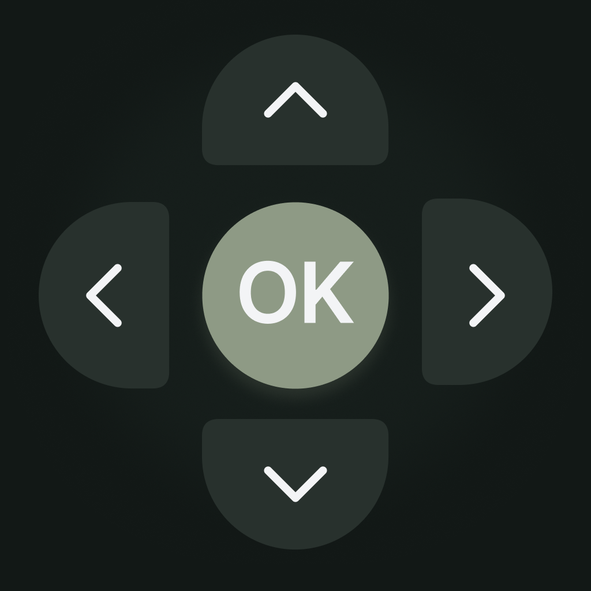
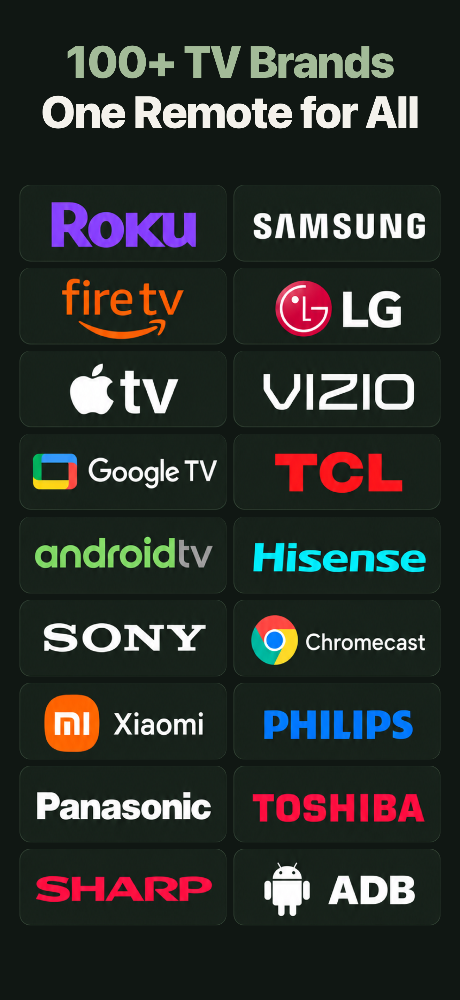
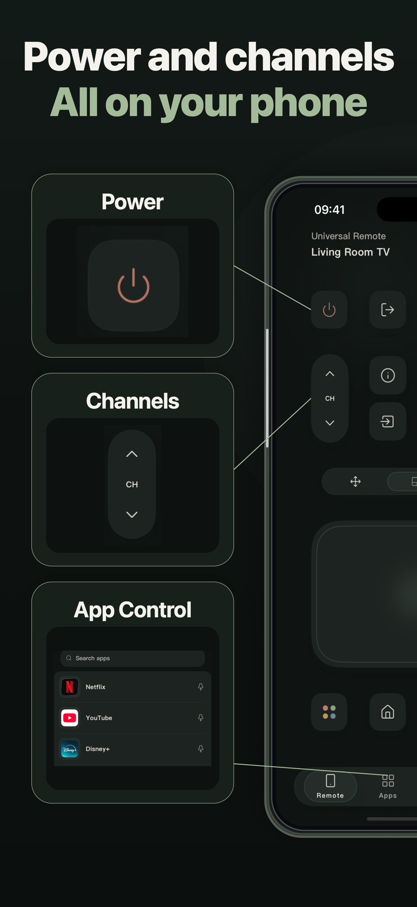
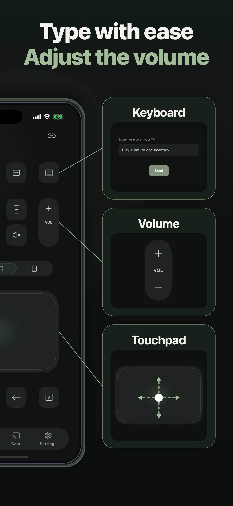

# CleanYourTV Skill

**Make Android TV cleanup easier and safer with your AI assistant.**

Use your AI assistant to review unwanted preinstalled apps and set up a simpler home screen with your favorite apps. CleanYourTV Skill adapts [Gathin23/cleanyourtv](https://github.com/Gathin23/cleanyourtv) into a reusable workflow for Android TV and Google TV: inspect your TV, review a cleanup plan, and apply only the changes you approve.

## Why use this skill?

- **Easier to use.** Install one reusable skill and describe what you want. Your assistant follows the relevant audit, cleanup, launcher, or recovery procedure, with copyable requests and references available when needed.
- **Safer execution by design.** The skill adds explicit device identity checks, a plan you approve before changes, protected-package rules, one-package transactions, and recorded recovery steps. Uncertain outcomes stop further changes instead of triggering blind retries.
- **Portable across assistants.** Plain Markdown and standard-library helpers keep the workflow independent of any model provider. It adapts to the tools and permissions available in your assistant, including plan-only use without device access.

These guardrails are designed to reduce wrong-device changes, unintended loss of TV functions, and mistakes from copying commands or package lists without checking the target TV. The original launcher and Setup Wizard stay enabled throughout this skill's workflow.

## What you can do

- **Clean up unwanted apps.** Review preinstalled apps and promotional services, understand what they do, and disable approved packages one at a time.
- **Personalize your home screen.** Build and configure the upstream lightweight, Apple TV-style launcher with a favorites dock, app grid, and themes. Switching the default Home depends on your firmware; the original launcher stays enabled.
- **Use the latest launcher features.** Review module cards individually, adjust launcher layout and motion, and configure remote-key helpers when requested. Optional Private DNS and existing private remote connections have [separate procedures](references/network-extras.md).
- **Keep track of every change.** Review expected effects and recovery steps before approving a change, then check that your essential TV functions still work.

Start with a request like:

```text
Use cleanyourtv-skill to help me clean up my Android TV
and set up a simpler home screen. Keep my streaming apps,
casting, and voice controls. Show me a plan before changing anything.
```

For device access, use an assistant with terminal access, Android SDK Platform Tools (ADB), and debugging authorization from your TV. You can also review plans in a chat assistant by providing the required command output. No root is required.

## What is included

- A portable [SKILL.md](SKILL.md) with progressively loaded references.
- An offline Python plan guard that rejects malformed plans, protected package names, missing baseline state, device mismatch, and stale snapshots. It emits command arguments but cannot execute them.
- Launcher, connection, recovery, and privacy procedures tied to a reviewed upstream revision.
- Standard-library tests, cross-platform CI configuration, behavioral evaluation cases, licensing, and contribution/security guidance.

## Quick start

1. Download the source or checked ZIP from the [v0.3.0 prerelease](https://github.com/songbihai/cleanyourtv-skill/releases/tag/v0.3.0). For the custom ZIP, verify the adjacent SHA-256 file before extraction. Do not run device commands from an unreviewed branch.
2. Open [SKILL.md](SKILL.md) in your assistant, or install this entire folder as a skill using your host's documented method. Preserve `references/` and `scripts/` beside it.
3. Ask: `Use cleanyourtv-skill to audit my Android TV. Start in plan mode. Do not change the device. I will provide its exact ADB endpoint.`
4. For a real operation, follow the snapshot and plan procedure in [plan-format.md](references/plan-format.md), review its output, and approve the exact change before execution.

To inspect the synthetic example without a TV, from the repository root:

```text
python3 scripts/plan_guard.py --snapshot examples/snapshot.synthetic.json --plan examples/plan.synthetic.json --demo
python3 -m unittest discover -s tests -v
python3 scripts/check_repository.py
```

`--demo` accepts only fixtures marked synthetic and labels output non-executable. It does not allow stale real snapshots. Never use fixture evidence to administer a device. Python 3.10 or newer is required for the helpers; they have no third-party dependencies.

## Model and host compatibility

The skill uses ordinary Markdown and the [Agent Skills format](https://agentskills.io/specification). Load it in an assistant that can read the skill and its references. The workflows below adapt to the tools, permissions, and context available in each host.

| Host capability | Use |
| --- | --- |
| Native Agent Skills loader | Install the whole folder; invoke `cleanyourtv-skill` using the host's syntax. |
| Codex | Copy the folder to `~/.agents/skills/cleanyourtv-skill/`; invoke `$cleanyourtv-skill`. Optional `agents/openai.yaml` supplies UI text. |
| Claude Code | Use the personal or project skill location and invocation described in [compatibility.md](docs/compatibility.md). |
| Gemini CLI | Use its documented skill discovery and consent flow; see [compatibility.md](docs/compatibility.md). |
| Chat assistant with file access, no shell | Read the skill and relevant references; produce plans and ask the user for command output. |
| No file/reference access | Provide the skill and the required reference text in context; stop if required instructions do not fit or are missing. |
| No reliable target selection, timeout, or approval mechanism | Audit/plan only; no device mutations. |

See [compatibility.md](docs/compatibility.md) for official host sources, copyable audit requests, argument handling, and capability fallbacks.

No API, vendor SDK, MCP server, model-specific system prompt, or paid service is required by the skill. Actual execution requires Android SDK Platform Tools and authorization on the TV. Building the upstream launcher additionally requires its JDK/Android SDK/Gradle toolchain and dependency downloads.

## Supported scope

Audit and carefully reviewed per-user disabling on Android TV/Google TV; build/install/configure the upstream launcher while keeping stock Home available. Samsung Tizen, LG webOS, Fire OS, managed devices, secondary-user mutations, rooting, flashing, and stock-launcher/setup-wizard disabling are outside this release. These limits are intentional even where upstream offers broader workflows.

Review real device output and confirm the target TV before each change. The offline guard checks plan structure, protected packages, device identity fields, and recovery data; firmware dependencies still require a review of the specific device. See [SECURITY.md](SECURITY.md).

## From the maintainer: TVRemoteX



TVRemoteX brings everyday TV controls to your iPhone and iPad: navigate with a touchpad, type with your phone’s keyboard, adjust volume, and launch apps on compatible TVs.

[View TVRemoteX on the App Store](https://apps.apple.com/us/app/tvremotex-universal-tv-remote/id6755671893)

<p>
  
  
  
</p>

Made by the maintainer of this skill. TVRemoteX is optional; the skill works independently. Features vary by TV model and platform. Some features require in-app purchases.

## Project status and publishing

**Version 0.3.0.** Synced to the reviewed [cleanyourtv source revision](https://github.com/Gathin23/cleanyourtv/tree/7c61d3c57e561323b85d7096ee2b686685b9b499), whose launcher is version 2.3. The offline helpers and packaging tools have a **95-test suite**. See [VALIDATION.md](VALIDATION.md) for completed checks and the [Actions tab](https://github.com/songbihai/cleanyourtv-skill/actions) for cross-platform CI results.

The skill builds on the upstream TV customization workflow. Consult upstream’s [device examples](https://github.com/Gathin23/cleanyourtv/tree/main/examples) for model-specific reports, then match the model, OS, and firmware to your TV. Keep device changes within the supported scope above and review each plan before execution.

See [upstream-review.md](references/upstream-review.md) for the reviewed revision and provenance, [evaluation.md](docs/evaluation.md) for assistant behavior scenarios, [release.md](docs/release.md) for publishing procedures, and the [Actions tab](https://github.com/songbihai/cleanyourtv-skill/actions) for current CI results.

To build a review archive containing only declared source and reviewed assets, run `python3 scripts/build_release.py --output /path/outside/repository/cleanyourtv-skill-0.3.0.zip`. It refuses existing output and writes a `.sha256` sidecar. The [audit report](docs/audit.md) records this review and its limits.

Instructions and helpers are MIT licensed; promotional images have [separate terms](assets/tvremotex/NOTICE.md). Upstream attribution is preserved in [NOTICE](NOTICE) and [LICENSE](LICENSE). This is an independent project, not an official upstream or Android project.
